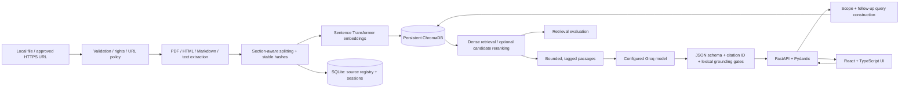

# RAG Chatbot over Technical Documents

**Citation-grounded question answering over technical documentation**

A full-stack retrieval-augmented generation (RAG) application for technical PDFs, Markdown, HTML and plain-text files. It indexes permitted documents with local sentence embeddings and persistent ChromaDB, retrieves relevant passages, and sends bounded evidence to a configured Groq model. Answers come back claim by claim: the system rejects unknown citation IDs and claims that fail a conservative textual-evidence check before display. Similarity distance is shown as distance, not as an answer-confidence probability.

## Problem and objectives

Technical documentation is lengthy, version-sensitive and fragmented. A standard chatbot can produce plausible but incorrect configuration details and fabricated sources. TechnicalDocs AI keeps the stages separate: document ingestion, deterministic provenance, retrieval, evidence-bounded generation, citation checking, and inspectable evaluation. It is a single-workspace, local-first engineering reference, not a production multi-tenant document platform.

## Architecture



LangChain supplies `RecursiveCharacterTextSplitter` and `ChatPromptTemplate` for the chunking and generation pipeline, and ChromaDB's supported native client handles fine-grained deterministic metadata operations. LlamaIndex is not part of the stack. See [architecture](docs/architecture.md).

## Technology and compatibility

Python 3.11 is the Docker default; local development requires Python 3.11–3.13 and Node 22. Versions are pinned in `pyproject.toml` and `frontend/package.json` (without transitive lockfiles). Selected published releases: LangChain 1.4.4, LangChain text splitters 1.1.3, ChromaDB 1.5.9, Sentence Transformers 6.1.0, Groq SDK 1.7.0. The default embedding is `sentence-transformers/all-MiniLM-L6-v2`, with 384 dimensions, and embeddings are normalized before cosine indexing. The first model run downloads weights, so allow for network access, a model license review, RAM and a local cache. GPU is optional.

### Install and run (local)

```bash
cd technicaldocs-rag-chatbot
python3.11 -m venv .venv
source .venv/bin/activate       # Windows: .venv\Scripts\activate
python -m pip install -e '.[dev]'
cp .env.example .env
# Edit .env: set GROQ_API_KEY and a model returned by your account's /models endpoint
python -m scripts.check_groq
python -m scripts.ingest_documents --dir data/sample_documents
python -m scripts.run_smoke_tests
uvicorn backend.app.main:app --host 127.0.0.1 --port 8000
```

In another terminal:

```bash
cd technicaldocs-rag-chatbot/frontend
npm install
npm run dev
```

Open `http://127.0.0.1:5173`. The backend serves interactive API docs at `http://127.0.0.1:8000/docs`. Without `GROQ_API_KEY` and `GROQ_MODEL` set, retrieval-only inspection works once dependencies and an index are in place, while grounded generation returns a provider configuration error instead of a mock answer. An empty index returns a documented abstention.

### Docker Compose

```bash
cp .env.example .env
# Set a strong ADMIN_TOKEN in .env before access beyond the local machine.
docker compose up --build
```

Open `http://127.0.0.1:8080`. Docker persists Chroma, SQLite and uploads in the `rag_runtime` named volume; `evaluation/results` is a host-mounted directory. Keep the internal backend port unpublished; the frontend nginx reverse proxies `/api`. A production deployment needs TLS, authenticated access, egress filtering, rate limits, resource quotas, backups, a data-retention policy and an organizational security review. `docker compose down -v` deletes persistent indexes and files.

## Groq configuration

The only model source is `GROQ_MODEL` in `.env`. The example is `llama-3.3-70b-versatile`, listed by the [Groq supported-model documentation](https://console.groq.com/docs/models) in Oct 2026; availability is account-dependent and can change. Run `python -m scripts.check_groq` to query active account models without a completion request. `GROQ_API_KEY` is never returned by `/api/config`, logged, or committed. The SDK has a bounded timeout and two retries for provider-managed transient failures; provider errors surface as HTTP 503. Groq usage counters are shown when returned.

## Ingest your own documents

```bash
python -m scripts.ingest_documents --dir /path/to/permitted/docs --collection default
```

Or open the Knowledge base view in the UI and upload PDF, `.md`, `.txt`, `.html` or `.htm` files. Extraction respects PDF pages, Markdown sections, code formatting and HTML main/article text; PDFs without extractable text report OCR required. Original bytes and the registry are saved under `runtime/` (excluded from Git). Uploading identical bytes in the same collection is deduplicated. The re-index action uses stored bytes, and deleting a document deletes its matching Chroma vectors and registry record. To use the URL ingestion endpoint, explicitly enable `ALLOW_URL_INGESTION=true`, set `ALLOWED_HOSTS` and make sure robots and terms permit it; HTTPS redirects and private IP hosts are denied. There is no automatic crawling.

Sample `data/sample_documents/` contains three short, independently authored, permissively distributable learning documents covering networking and systems material. They are not copies of third-party licensed corpora. The current Juniper [CLI overview](https://www.juniper.net/documentation/us/en/software/junos/cli/topics/topic-map/cli-overview.html) and [CLI guide](https://www.juniper.net/documentation/us/en/software/junos/cli/index.html) are starting points for permitted, user-initiated ingestion. Juniper's [documentation portal](https://www.juniper.net/documentation/) may migrate to HPE sites; don't hardcode scraped page layouts or mirror the site's corpus without permission.

## API quick reference

| Method | Endpoint | Purpose |
|---|---|---|
| GET | `/api/health` | Process/dependency health |
| GET | `/api/config` | Safe model/index configuration |
| GET | `/api/collections` | Scoped counts and available collection labels |
| GET | `/api/documents` | Document inventory |
| GET | `/api/documents/{id}` | Document metadata |
| POST | `/api/documents/upload` | Multipart file and collection |
| POST | `/api/documents/url` | Explicitly approved HTTPS source |
| GET | `/api/documents/{id}/original` | Authenticated download of uploaded original bytes |
| POST | `/api/documents/{id}/reindex` | Re-index stored bytes |
| DELETE | `/api/documents/{id}` | Delete document and vectors |
| POST | `/api/collections/reset` | Explicit confirmed collection-wide deletion |
| POST | `/api/retrieve` | Inspect ranked evidence |
| POST | `/api/chat` | Verified claim-by-claim answer |
| POST | `/api/chat/stream` | SSE status and validated final answer, not token streaming |
| GET | `/api/sources/{chunk_id}` | Exact indexed excerpt |
| DELETE | `/api/sessions/{session_id}` | Clear scoped session history |
| POST | `/api/evaluate` | Synchronous reproducible evaluation |

Example (requires an index and a configured provider):

```bash
curl -s http://127.0.0.1:8000/api/retrieve \
  -H 'Content-Type: application/json' \
  -d '{"question":"Which command shows compact Junos interface status?","scope":{"collection":"default","document_ids":[]}}'

curl -s http://127.0.0.1:8000/api/chat \
  -H 'Content-Type: application/json' \
  -d '{"question":"What does commit check do?","scope":{"collection":"default","document_ids":[]}}'
```

If `ADMIN_TOKEN` is set, add the header `X-Admin-Token: <your secret>` to protected requests. The frontend has an in-memory admin token field in its sidebar; enter the configured value when using protected API routes. Use HTTPS in any non-loopback deployment and don't store the token in browser storage.

## Retrieval, citation and context contract

`/api/retrieve` returns exact passage text and collection-validated metadata; Chroma's cosine distance is displayed as distance, not confidence. Options include `RETRIEVAL_STRATEGY=dense|hybrid|mmr` (the hybrid implementation reranks dense candidates lexically, not a full-corpus BM25 index) and an optional `RERANKER_MODEL` for a Sentence Transformers CrossEncoder. Tune any mode against evaluation results rather than intuition. Context is capped by number of chunks and characters, and citation labels `S1`, `S2`... are fresh per request. Groq is prompted to return JSON containing independent claims and supporting IDs. The validator rejects nonexistent IDs, malformed claims and weak surface overlap, and no unsupported fallback answer is generated.

This validation is a lexical check, not a formal entailment proof, so it can reject legitimate paraphrases or miss a semantically unsupported claim that happens to share words. Human review remains necessary for high-stakes operations. See [retrieval](docs/retrieval.md) and [citations](docs/citations.md).

## Test and evaluation

```bash
python -m compileall -q backend scripts
pytest -q
ruff check backend --select E4,E7,E9,F
cd frontend && npm run build
# After indexing all three documents:
cd .. && python -m scripts.evaluate_rag --k 5
# Optional provider-backed run, costs/availability dependent:
python -m scripts.evaluate_rag --k 5 --generate
```

The bundled sample documents and the 12-question set are small original examples written for this project, not a validated research benchmark. The question set covers direct, CLI, configuration, troubleshooting, multipassage, follow-up and out-of-scope cases, and is annotated against document titles. Evaluation computes Precision@k, Recall@k, MRR, nDCG@k and Hit Rate@k against those preannotated titles, with optional chunk-level judgments; empty-relevance questions are excluded from positive-relevance macro metrics. Each run writes per-question retrieved IDs and metrics into `evaluation/results/<run-id>.json`. Answer evaluation uses a literal phrase match and a citation-ID existence check rather than semantic faithfulness scoring, so manual adjudication is still needed for semantic quality. See [evaluation](docs/evaluation.md).

## Privacy and safety

Documents are untrusted data, never executable instructions; uploaded content does not modify server policies. PDF or markdown code snippets are displayed as text only. URL ingestion uses explicit approved hosts, public-IP checks, robots.txt, no redirects, response size caps and timeouts. Preflight DNS checks cannot fully eliminate DNS rebinding, so production also needs network-level egress restrictions. SQLite session history expires after 12 hours during subsequent session access, can be explicitly deleted, and does not share history between random UUID session IDs. This is not a user-authenticated multitenant system; a deployed system needs real identity, per-document authorization, quotas, isolation and review.

## Known limitations

- Chunking is character-aware rather than tokenizer-aware and may split long code blocks.
- Citation relevance is lexical, not NLI entailment, and adversarial prompt injection cannot be categorically eliminated.
- SSE provides validated final responses rather than token-by-token generation; the frontend currently uses the abortable non-streaming `/api/chat`.
- URL fetch blocks redirects and accepts only permitted hosts, so requests may fail closed on unusual robots.txt behavior.
- There is no job queue, comprehensive RBAC, full-multitenant isolation, OCR, transactional cross-store ingest, corpus-level BM25, or evaluation-based model selection.

See [deployment](docs/deployment.md), [security](docs/security.md), [troubleshooting](docs/troubleshooting.md) and the [project report outline](docs/project_report_outline.md) for more detail.
