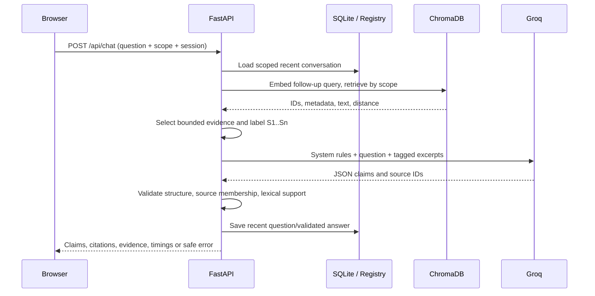

# Architecture and data flow

**RAG** retrieves a small set of relevant corpus passages at question time and gives those passages to a generation model. Compared with direct LLM prompting, it can expose provenance and update the knowledge base without retraining model weights, but can still fail from extraction loss, retrieval misses and unsupported generation.

## Modules

- `core/config.py`: validated environment configuration, safe collection names, deterministic local paths.
- `services/extraction.py`: PDF pages via pypdf, structured HTML via BeautifulSoup, UTF-8 Markdown/text. No destructive command normalization.
- `services/chunking.py`: heading-aware segments with LangChain recursive splitter and stable SHA-256-derived chunk IDs. A built-in fallback splitter is used when the LangChain splitter is unavailable.
- `services/registry.py`: SQLite provenance, indexing states, session scope and TTL.
- `services/vectorstore.py`: normalized Sentence Transformer embeddings and persistent Chroma collection; model/dimension/version signature prevents vector mixing.
- `services/ingestion.py`: dedupe, file preservation, index upsert, document replacement/deletion and tightly scoped URL fetch.
- `services/retrieval.py`: scoped dense search; optional candidate lexical fusion, MMR-style diversity or CrossEncoder ranking; bound context.
- `services/generation.py`: official Groq SDK, LangChain prompt composition, retry/timeout, usage accounting; treats source text as untrusted.
- `services/citations.py`: typed claim structure, ID resolution, surface-evidence check; fail closed.
- `services/rag.py`: orchestrates session and query interpretation, retrieval, generation and tracing.
- `services/evaluation.py`: annotated retrieval metrics and persisted experiment artifacts.
- `main.py`: typed FastAPI request validation, error mapping and endpoint exposure.
- `frontend/src/App.tsx`: browser views backed by the backend HTTP API.

## Persistence

Chroma is stored at `runtime/chroma`, uploaded original bytes in `runtime/uploads` and SQLite at `runtime/registry.sqlite3`. Deleted document vectors are selected by `document_id`; only the target's persisted original bytes are removed. SQLite and Chroma cannot be atomically committed together; interrupted indexing can leave partial vectors. Operators should inspect failed records and re-index/restore from backups before declaring consistency.

## Design boundaries

Authentication is a single static admin token if enabled, not OAuth/RBAC. The session lifecycle is a random unguessable ID scoped to the selected collection/document set. No session history is implicitly evidence. Full tokenizer-aware chunking, transactional re-index, durable async jobs, OCR and corpus-level sparse retrieval are planned extensions rather than current features.
